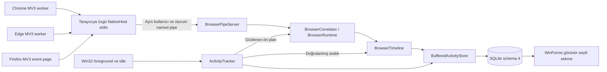

# Family Activity Monitor — 2.0.0-prototype mimarisi

## Katmanlar ve veri yolu

Mevcut `Agent → Infrastructure → Core` ayrımı ve oyun/idle/monoton saat sistemi korunur. NativeHost yalnızca Core protokol koduna bağlı, küçük bir Windows konsol köprüsüdür. Eklenti kodu ortak TypeScript namespace'lerinden derlenir; yalnızca platform adaptörü ve manifest bağlamı farklıdır. Yeni runtime bağımlılığı eklenmedi; TypeScript geliştirme bağımlılığı lock dosyasında sabittir.

## Süre hesabı ve ihtiyatlı atıf

`ActivityTracker` saniyelik mevcut kaynağı okur; `SampleObserved` olayı saklama öncesinde gelir. `IntervalConfirmed` yalnızca genel süre kaydı başarıyla depoya iletildikten sonra aynı monoton UTC ekseninde yayınlanır. Boundary bildirimi pause/stop/izin çekme/kilit/uyku/eşik-hata-silme sınırlarını tarayıcıya taşır. İzin geri çekme callback hatasıyla engellenmez.

`BrowserCorrelator` OS süreç ailesi ve HWND değişimi, izin değişimi veya bağlantı değişiminde yeni rastgele epoch üretir. Eklenti bu politikayı aldıktan sonra odaktaki normal penceresinin aktif sekmesini yeniden bildirir. Aynı tarayıcının tüm bağlı profilleri taze cevap vermeli ve yalnızca biri odak iddia etmelidir. 20 saniyelik lease, artan sıra numarası ve saniyede 20 mesaj sınırı vardır. Bozuk/replay mesaj bağlantıyı kapatır; şeması geçerli ama eski epoch'a ait yoldaki mesaj atılır. Özel, eksik, eski veya çoklu odak bağlamına site süresi verilmez; UI nedeni gösterir.

WebExtension window ID bir Win32 HWND değildir. Bu prototip aynı süreç ailesi + taze odak challenge'ı kullanır; yerel tarayıcı pencere API'siyle birebir HWND kanıtı veya imzalı oturum attestation'ı yoktur. Çoklu profil/kilit/odak kabulü gerçek tarayıcılarla ayrıca yapılmalıdır. Belirsizlikte yanlış site tahmini yapılmaz; eksik atıf mümkündür. OS geçişleri yaklaşık 1 saniye, eklenti olayları 250 ms birleştirmeyle gözlenir; kesin milisaniye doğruluğu iddia edilmez.

`BrowserRuntime` pipe thread'inden gelen güncellemeleri sınırlı kuyruğa alır ve tracker iş parçacığında, gerçek geliş zamanına göre işler. Disconnect olayı o anda null bağlam kuyruğa koyar. Uzun pause'ta metadata veya kuyruk birikmez. `BrowserTimeline` yalnızca genel tracker'ın onaylanmış pozitif aralıklarını bölüştürür; site süresini genel toplama eklemez. Tab/pencere/bağlantı değişimi aynı domain olsa bile dönem sınırıdır. Parent `ActivityId` ve OS pencere eşleşmesi gerekir. Son girdiden sonraki doğrulanmamış idle zaman eklenmez. Kontekst 512, doğrulanmış cursor 1024 girdide sınırlıdır; uzun gecikmede tahmin yerine eksik kayıt tercih edilir.

## İletişim ve tehdit sınırı

Tarayıcı, izinli Native Messaging manifestindeki tam host exe'sini açar. Chrome/Edge sabit origin; Firefox sabit addon ID + beklenen manifest yolu argümanı doğrulanır. Host kendi browser varyantını exe adından alır ve parent süreç ailesini kontrol eder. Pipe sunucusu gerçek istemci PID'sinin exe tam yolunu, host da gerçek sunucu PID'sinin Agent tam yolunu doğrular. Pipe adı SID+oturum hash'idir; `CurrentUserOnly` kullanılır. Harici TCP portu yoktur.

Çerçeve 4 bayt little-endian uzunluk + UTF-8 JSON; en fazla 8192 bayt/derinlik 8. Fazladan/yinelenen alanlar reddedilir; domain/yol/sorgu tekrar Agent'ta normalize edilir. 16 istemci, 8 policy outbox, 1024 update sınırı; hello 5 saniye, sessiz istemci 35 saniye timeout. Sunucu dinleme görevi `Task.Run` üzerinde başlar: kapanış UI synchronization context'inin pompalanmasını beklemez. Eklenti/Agent çıkışı bağlantıyı ve metadata toplamayı keser. Aynı Windows hesabında exe/ayar değiştiren kötü amaçlı yazılımı engelleyen bir güvenlik ürünü değildir; kod imzalama/OS hesap izolasyonu kapsam dışıdır.

Eklenti olayları tabs/windows/storage/permission değişimidir. Content script, history, cookies, DOM, sayfa başlığı veya uzak istek yoktur. Opsiyonel tabs izni, ayrıca Firefox veri toplama izni gerekir. Async okumalar generation ile geçersizleştirilir; izni çekilmiş eski sonuç gönderilemez. Değişmeyen snapshot gönderilmez. 10 saniyelik heartbeat metadata içermez, sekme sorgusu yapmaz. Eklenti izni kapalıyken host başlatılmaz; kopmada sınırlı geri çekilmeli yeniden bağlanma vardır.

## Kalıcılık ve bakım

Üretim `BrowserDatabaseUpgradeService` kapısından şema 4'e geçer: mevcut DB için kullanıcı onayı, SQLite Backup API kopyası, quick_check ve foreign_key_check, ardından transaction migration. Eski aktiviteler, oyun kataloğu ve şema 3 ön plan tablosu korunur. Yeni `browser_visits`, `activities` parent'ına ON DELETE CASCADE ile bağlıdır. Eski `DatabaseUpgradeService` test/araç uyumu için şema 3 hedefini korur; üretim giriş noktası onu doğrudan kullanmaz. Yeni DB için boş şema 4 onaysız oluşturulur; kişisel DB geliştirme sırasında açılmaz.

Aynı `BufferedActivityStore` genel/oyun/tarayıcı kuyruklarını tek atomic SaveBatch'te yazar: önce parent activity, sonra alt kayıtlar. Toplam 1024 dirty kayıt, her aktif cache 128 girdidir. Değişmeyen UUID yazısı atlanır. Yaklaşık 5 saniyelik düşük öncelikli FULL synchronous WAL transaction; tamamlanan dönem acil flush isteyebilir. Normal kapanış flush yapar, güç kesintisinde son commit edilmemiş kuyruk kaybolabilir. UI günlük aggregate'i bekleyen kayıtların eski SQL katkısını çıkarıp yenisini ekleyerek okur; çift sayılmaz.

Tarayıcı saklama 30 gün varsayılan, 1–365 gün. Runtime saatlik veya ayar değişiminde mantıksal cutoff uygular; pending kayıtlar kesilir ve eski kısımlar yeniden dirilemez. Oyun modu fiziksel prune/checkpoint/VACUUM'u erteler. Daha sonra silme ve sınır aşan satırı kesme çalışır. Tarayıcı silme yalnızca browser_visits + ilgili kuyruğu temizler; genel silme cascade ve tüm kullanım kuyruklarını temizler. Ayrı backup/settings/PIN/katalog korunur. Yükseltme öncesi yedek yalnızca yeni hedef kopyaya doğrulanmış geri dönüş testiyle sınanır; canlı dosyayı otomatik ezme yoktur.

## Arayüz, başlangıç ve PIN

Mevcut ekran korunur, iki tarayıcı sekmesi eklenir. Tarih/tarayıcı filtreleri, genel tarayıcı toplamı, sitelerin alt süreleri ve son 500 dönem gösterilir. Görünür seçili sekme normalde 5, oyunda 15 saniyelik tek-uçuşlu arka plan sorgusu kullanır. Gizli/minimize tablolar okunmaz. Ayrıntı/sorgu sütunları mevcut izin kapalıysa gizlenir. İzin azaltma önce toplama politikasını daraltır; kaydetme hatası toplamanın devam etmesine izin vermez.

`AutoStartService` sadece açık opt-in ile tırnaklanmış mutlak exe + `--autostart` komutunu HKCU Run'a yazar. Kayıt değişimi ile ayar yazımı hata halinde geri alınır. Otomatik takip; bu argüman, eşleşen kayıt, iki startup seçimi, güncel genel izin ve etkileşimli hazır kullanıcı oturumu ister. Normal açılış kapalı; servis/SYSTEM/Task Manager engeli yoktur. Tepsi görünür, otomatik açılış bildirimi vardır.

PIN: saltlı PBKDF2-SHA256 600.000, bağımsız rastgele kurtarma kodu hash'i, sabit zamanlı karşılaştırma, kalıcı 5-deneme/15-dakika bekleme. KDF UI dışında çalışır. Yalnızca ebeveyn ayarları ve başlangıcı etkinleştirme korunur. Pause/stop/izin çekme/çıkış PIN kontrolü çağırmaz. Aynı OS hesabındaki dosya manipülasyonu engellenmez.

## Korunan oyun mimarisi ve kanıt

Oyun keşfi, güvenilir tam yol/paket eşleştirmesi, manuel isimler, Steam/Epic/Xbox/Minecraft sağlayıcıları, XInput var/yok gözlemi, cache, debounce, oyun modu ve ertelenen ağır işler korunur. Ayrıntılar [oyun belgesinde](games.md); önceki tasarımın tarihsel metni [1.2.1 mimari arşivinde](architecture-1.2.1.md). Oradaki yalnız-uygulama/şema 3/her-açılış-kapalı ifadeleri eski sürüme aittir.

Testler sahte saat/foreground/API, geçici DB, registry adaptörü ve izole pipe kullanır. UI bitmap ve %100/%150 geometri kontrolü vardır; gerçek tarayıcı/OS DPI/reboot/oyun başarısı değildir. Kanıt ve sınırlamalar [Görev 2 raporunda](task-2-report.md), [manuel kabulde](task-2-manual-tests.md), [gizlilikte](privacy.md).

Teknik uyumluluk: [Chrome Native Messaging](https://developer.chrome.com/docs/extensions/develop/concepts/native-messaging), [Edge](https://learn.microsoft.com/en-us/microsoft-edge/extensions/developer-guide/native-messaging), [Firefox](https://developer.mozilla.org/en-US/docs/Mozilla/Add-ons/WebExtensions/Native_messaging), [Firefox background](https://developer.mozilla.org/en-US/docs/Mozilla/Add-ons/WebExtensions/manifest.json/background), [Windows Run](https://learn.microsoft.com/en-us/windows/win32/setupapi/run-and-runonce-registry-keys), [PBKDF2 çalışma faktörü](https://cheatsheetseries.owasp.org/cheatsheets/Password_Storage_Cheat_Sheet.html).
